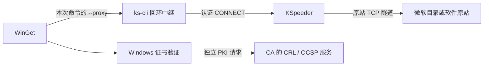

# WinGet 加速原理与可行修复路线（2026-10-28）

结论：现有 `ks-cli winget` 是命令范围的认证 CONNECT 中继；它还没有把 WinGet 的
原站安装包下载接入 `ks-cli download --mode=auto` 的文件下载策略。
本轮在 Windows AMD64 / WinGet v1.29.380 上证明了一条可行路线：**ks-cli 自动选路
预下载原包，WinGet 复用原包并重新验证哈希**。原生导出成功、实际程序运行和坏哈希
拒绝均已通过；这是原型验证，尚未实现产品适配器，也未证明所有包的安装通过。

## 当前链路

`kspeeder-cli/internal/app/winget_command.go` 在本机回环地址创建临时监听，先验证上游
认证，再为原生命令追加 `--proxy`；凭证不会传给 WinGet。退出后关闭中继及连接，
没有安装或启动 Windows KSpeeder，也不修改 Windows 默认代理。

`kspeeder/cmd/multi/admin_connect_proxy.go` 对普通原站使用 TCP dial；只有特定
LinkEase 域名的 443 端口映射到本地 TLS 服务。WinGet 的原始 GitHub URL 走的是
透明隧道，TLS 由 Windows 与原站建立。此处不能读取加密的安装包 URL/内容，也没有
调用文件下载器的自动竞速、缓存及下载路由。因此，这条路径主要提供网关出口，不能
将它描述为已经使用了完整的文件下载择优策略。

微软的[代理设计](https://github.com/microsoft/winget-cli/blob/master/doc/specs/%23190%20-%20Proxy%20Support.md)
及[下载器选择实现](https://github.com/microsoft/winget-cli/blob/v1.29.380/src/AppInstallerCommonCore/NetworkSettings.cpp)
说明，显式代理使 WinGet 使用 WinINet；切换 DO 不能直接绕过这个条件。
同一设计也说明安装器自身发起的网络请求不保证遵循 WinGet 代理。

## 本轮定位

1. Windows 上三个官方 HTTP 地址（Sectigo 中间证书、Sectigo Root E46 CRL、
   USERTrust ECC CRL）显式直连均为 curl 退出 56、HTTP 000、0 字节；控制端对
   相同 URL 均为 HTTP 200，分别取得 867 / 368 / 906 字节。
   这将问题缩小到 Windows 端点或它的网络路径，尚未判定具体重置设备。
2. 通过真实 `startWingetProxy` 的本地协议探针，普通 HTTP GET 得到 405。
   这证实了协议能力缺口；**不等于已经证明 CryptNet 使用了该中继**。
   仅增加 GET/POST 转发，不能保证系统证书查询会继承 WinGet 的命令代理。
3. 原生命令经现有认证 KSpeeder 访问固定 `jqlang.jq` / 1.8.2 / x64，仍以
   `0x80072f19` 失败，没有导出安装包。公开 PKI 查询失败与既有 CAPI2 证据一致。

[微软 Crypt32 语义](https://learn.microsoft.com/en-us/windows/win32/seccrypto/certificate-revocation-list-semantics)
将 Cryptnet URL 缓存、系统存储及在线 OCSP/CRL 检索区分开来，不能假定本次 WinGet
代理覆盖全部检索。此前 CurrentUser CA 修复通过而原生 WinINet 仍失败的结果保持不变。

## 原生缓存复用原型

目标机的[对应版本下载流程](https://github.com/microsoft/winget-cli/blob/v1.29.380/src/AppInstallerCLICore/Workflows/DownloadFlow.cpp)
先查找已下载的安装包并计算哈希；命中后仍执行 `VerifyInstallerHash`、重命名及
适用的安全标记流程。只有未命中时才调用安装包网络下载器。

本轮使用新任务目录及仅对子进程生效的 TEMP/TMP，不覆盖原有全局缓存。
WinGet 缓存布局按 v1.29.380 的实际源码和真实日志核对。

| 检查 | 结果 |
| --- | --- |
| 未预置原包的原生 WinGet 下载 | 失败，原生退出 `0x80072f19`，无导出文件 |
| ks-cli 下载同一原包 | 成功；auto / adaptive_race，原生回执选择 admin_proxy |
| 原包完整性 | 1,035,264 字节；冻结 SHA256 与实际文件、WinGet 导出清单均一致 |
| 原生 WinGet 复用 | 退出 0；日志明确记录 existing installer file hash matches，导出 EXE 和 YAML |
| 实际程序运行 | 对已验证导出的 EXE 执行 `--version`，退出 0，输出 jq-1.8.2 |
| 坏哈希缓存 | WinGet 识别并拒绝；随后正常网络重试仍报 12057，没有导出文件 |
| 配置及清理 | 检查的 HKCU/HKLM 默认代理值不变；Windows 的 winget、ks-cli、KSpeeder 进程均为 0；控制端临时网关和转发均已停止 |

原包 SHA256：`a6fc67fedaf9128a3309a1e2ebb8b986aeccf70122ee46d2cb4849e423f0c627`。
没有更改清单原 URL，没有设置忽略哈希、证书或吊销检查选项，没有证书库写入。
原型仅复用了 WinGet 本来支持的已下载文件验证路径；**系统在线吊销可达性仍未修复**。
本轮不声称双端冷缓存、加速倍率或全新目录源索引刷新通过。

原型初始运行后调整了三次测试脚本：处理 PowerShell 5 原生 stderr 语义及下载参数，
避免依赖在该 PowerShell 7 环境不可加载的 Appx 模块，最后处理本任务 WinGet 失败后
留下的零字节占位文件。仅替换已确认属于本任务且为空、不是链接的对象；其他冲突保持。
这些测试脚本错误未计为产品成功或产品修复。历史原始失败保留在仓库外。

## 建议实施任务树及验收

1. **下载计划**：让 owner 工作流确定受信源、准确版本、架构、scope、locale、原 URL
   和原哈希，并与 WinGet 实际选择一致。验收：歧义、不支持的版本/类型、未知来源均明确失败。
2. **下载准备**：复用现有文件下载引擎的 auto 策略，保留 TLS 和哈希检查，再将原包
   原子写入隔离的、由本次任务管理的缓存。验收：错哈希、截断、链接及外来文件不激活、不覆盖。
3. **原生交接**：由 WinGet 完成缓存复核和适用安全检查，保留原始退出状态。
   验收：未预置失败、预置成功、坏包拒绝三组对照均通过；独立证明下载、安装及实际使用。
4. **扩大范围与分发**：增加签名 EXE/MSI、依赖及版本兼容测试，再更新技能入口、
   生成预设、消费者和来源锁。Microsoft Store、安装器自下载及新的源索引更新另设验收，
   不将 jq portable 的下载成功推广过去。

同时保留 PKI 网络修复路线：定位这些官方 HTTP 请求的重置点并定向恢复可达性。
它有助于源刷新、签名验证及安装器自身网络行为；应与下载适配分别验证。
补全代理 HTTP 协议可以作为独立能力，但不能承诺单独解决原生 CryptNet 问题。

本轮未修改产品代码、未安装/卸载软件、未发布或推送；只新增诊断结果。
机器摘要见 [winget-routing-research-20261028-results.json](winget-routing-research-20261028-results.json)。
设备绑定、认证、原始日志、原型脚本及目标任务目录仅保存在仓库外的私有证据中。
